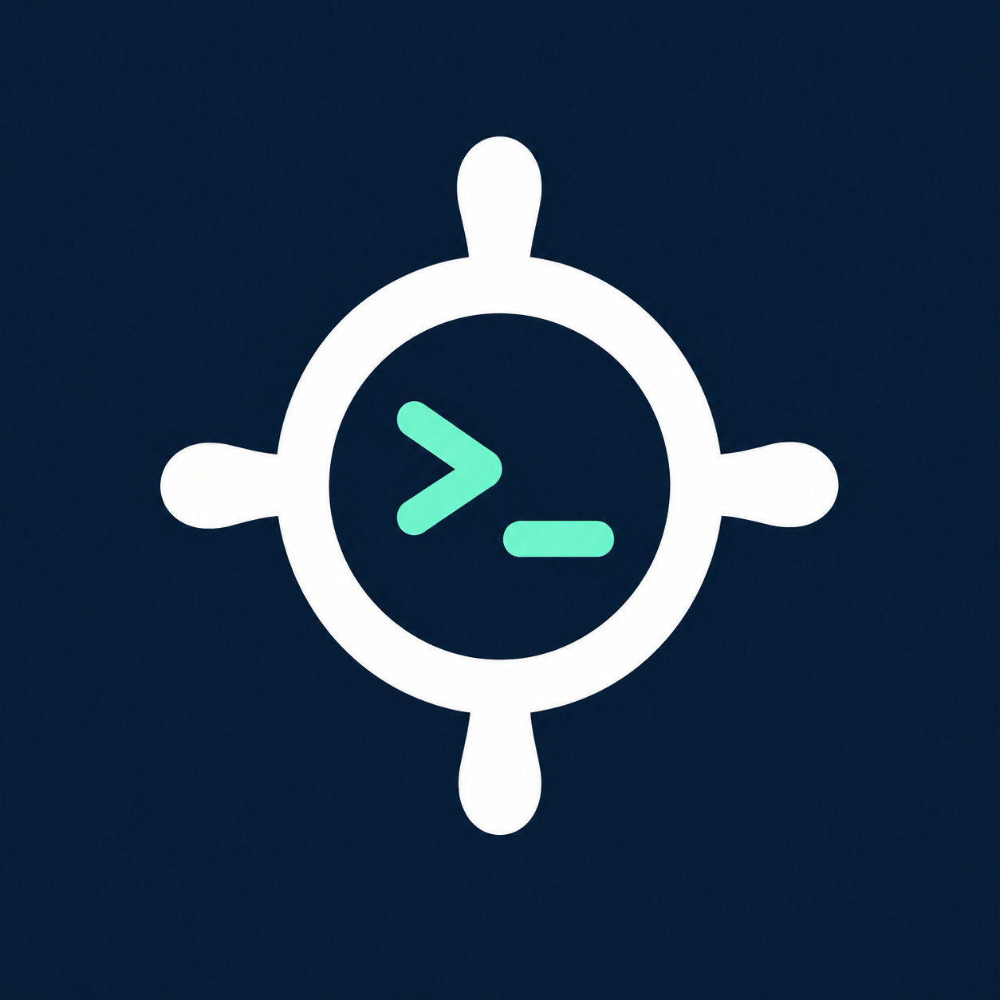

# CodeHelm

<p align="center">
  
</p>

<p align="center">
  <strong>Let Claude write the code. You steer the ship.</strong>
</p>

<p align="center">
  A lightweight human-in-the-loop workflow for Claude Code.
  <br />
  Recommended for engineers who love AI but refuse to surrender the steering wheel.
  <br />
  Specify → Plan → Implement → Audit: one tested and reviewable change at a time.
</p>

<br>

No endless specification documents. No mysterious AI-generated commits. No waking up to discover Claude refactored your entire application. Just clear requirements, documented decisions, automated tests and a human firmly holding the wheel.

**AI is your crew, not your captain.**

## The four skills

- **`/specify` — Understand the destination.** Turn incomplete briefs into clear, approved requirements; optional when the task is already well-defined.
- **`/plan-tasks` — Chart the course.** Decide how to build it and break the work into small reviewable tasks.
- **`/implement` — Sail one leg at a time.** Implement a single approved task, verify it, then stop for human review.
- **`/audit` — Check the navigation.** Compare specifications, decisions, code and test evidence.

No AI-agent-specific project instructions or LLM evaluation requirements are included in this backend starter.

## Structure

```text
.claude/skills/
  specify/
    SKILL.md
    assets/specification.md
  plan-tasks/
    SKILL.md
    assets/{plan,decisions,verification}.md
  implement/SKILL.md
  audit/SKILL.md
```

## Install into your project

Import the `.claude/skills/` into the root of your repository.

```bash
# From the directory containing the extracted CodeHelm package:
cp -R .claude/skills/. /path/to/my-project/.claude/skills/
```

Create the destination `.claude/skills/` first if needed and review existing same-named skills before copying so you do not overwrite them. Run Claude Code from the target project root.

## Skill usage: terminal, context and model

A **fresh Claude Code session** is more important than opening a new terminal. You can start a new `claude` session in a fresh terminal **or** run `/clear` in the existing Claude Code terminal, but only after decisions and progress are saved to Markdown. Use `/model` to choose a model; these are suggestions, not hard requirements or settings embedded in the skills.

| Skill | Fresh session? | Suggested model | Why |
| --- | --- | --- | --- |
| `/specify` | Prefer a fresh session when starting from a new or long assignment | **Opus** for ambiguous briefs; **Sonnet** for straightforward ones | Careful business-question discovery without unrelated implementation context |
| `/plan-tasks` | Prefer a fresh session after the specification is approved | **Opus** for architecture/trade-offs; **Sonnet** for small changes | Build a plan from saved requirements rather than old conversation assumptions |
| `/implement` | Prefer a fresh session **for each approved task** | **Sonnet** by default; **Opus** for difficult concurrency or debugging | Reduce context and keep each reviewable change narrowly scoped |
| `/audit` | **Yes**, use an independent fresh session when practical | **Sonnet** for task audits; **Opus** for critical/full reviews | Review evidence skeptically without relying on the implementation discussion |

**Practical commands:** `/model opus` or `/model sonnet`, then invoke the skill. After a completed phase or task, use `/clear` (or exit and start `claude` again) **only after** recording decisions, test results and unfinished work. Use `/compact` instead if a task is still in progress and the context is long. You don't need a new terminal window for every skill and frequent model switching mid-task is unnecessary.

## 0. Specify (optional: for an incomplete business brief)

Store the original project brief unchanged in a markdown file, then run:

```text
/specify docs/assignments/<project-brief>.md
```

Claude extracts only sourced requirements, identifies gaps, asks **business clarification questions** and **stops**; when stakeholders are unavailable you approve clearly documented assumptions. Claude then drafts a specification without architecture or implementation tasks and **stops again for approval**. After approval it saves:

```text
docs/specifications/<spec>.md
```

If you already have an approved specification, skip this phase.

## 1. Plan

```text
/plan-tasks docs/specifications/<spec>.md
```

Or without a formal specification:

```text
/plan-tasks Add GitHub Actions for unit and integration tests
/plan-tasks Add a Dockerfile with a smoke test
/plan-tasks Fix duplicate booking creation
```

Claude reads sources, asks focused clarification questions, **stops for your answers**, proposes architecture and small tasks, **stops for approval**, then writes:

```text
docs/plans/<plan-name>/plan.md
docs/plans/<plan-name>/decisions.md
docs/plans/<plan-name>/verification.md
```

It suggests a branch; **you** create/switch branches and commit the planning docs when ready. Keep specifications private if the employer requires it.

### Example of small, reviewable tasks

For illustration, a plan for an **Inventory Reservation API** might contain tasks like these. This is **not** a fixed task list: `/plan-tasks` must derive the actual tasks from the approved requirements and decisions.

| Task | Small, reviewable change | Example verification |
| --- | --- | --- |
| `S01` | Establish the application, persistence setup, and working test infrastructure | Build succeeds; unit and integration suites run |
| `S02` | Expose a read-only product availability endpoint | Availability unit tests and API/database integration tests |

Each task should have acceptance criteria, links to applicable requirements, and a suggested commit message. **One task means one proposed reviewable commit**; the complete unit and integration suites still run after every implementation task.

## 2. Implement one task

```text
/implement <plan-name> <task-id>   # for example, /implement booking-api S01
```

Claude reads the approved plan and original sources, checks for drift, confirms every dependency is `DONE`, proposes the file edits and **stops for your approval**. After approval it implements exactly one slice, runs the complete unit and integration suites plus relevant specialized checks, checks docs against code, sets the task to `READY FOR HUMAN REVIEW` and **stops for your review**. It must not stage, commit, push or continue to S02.

When you have reviewed and accepted the task, mark it `DONE` **before** committing, so the status change lands in the task's own commit:

```text
/implement <plan-name> <task-id> --done   # for example, /implement booking-api S01 --done
```

If you forget, the next `/implement` run asks which `READY FOR HUMAN REVIEW` tasks you have accepted and marks them `DONE` before it changes anything else. When those status lines are the only uncommitted changes in `plan.md`, it recommends committing them on their own (for example, `docs: mark S02 as done`) before you approve its proposal, so the next task's commit holds only its own work. If you skip that, the status changes are part of the next task's diff, and the handoff says so.

## 3. Audit

```text
/audit <plan-name> <task-id>   # scoped review before the proposed commit
/audit <plan-name>             # full review at milestone / delivery
```

Claude checks source requirements ↔ plan ↔ decisions ↔ code ↔ executed tests, then writes grounded evidence to `verification.md`. Each run also appends a row to the file's audit log (date, revision, scope, summary, open findings) and never rewrites earlier rows, so repeated audits keep their history. The audit does **not** change implementation code or create Git commits. Running an audit in a separate fresh Claude session provides more independent review.

## Core rules

- Specify (only if needed), then plan and question first; **no modifications before approval**.
- No automatic branch creation, staging, commits or pushes.
- One approved implementation task per invocation, started only when its dependencies are `DONE`.
- Full unit **and** integration suites for each proposed code commit. If not yet available, bootstrap both suites first.
- Document meaningful decisions, keep task-to-requirement traceability and audit code↔docs.
- Keep plans proportionate; small chores shouldn't require invented architectural alternatives.
- If sources or requirements change, pause and request re-approval before proceeding.

## Note on task status

Each task in `plan.md` carries one status, defined in the plan's "Task status lifecycle" section:

| Status | Meaning | Set by |
| --- | --- | --- |
| `NOT STARTED` | Approved; no work begun | `/plan-tasks` |
| `BLOCKED — <reason>` | A mandatory check failed or could not run, or a deviation needs approval | `/implement` |
| `READY FOR HUMAN REVIEW` | Implemented and verified locally; not yet accepted by you | `/implement` |
| `DONE` | Reviewed and accepted by you | `/implement … --done`, or `/implement` when you confirm it at the start of a later run |

`READY FOR HUMAN REVIEW` is **not the same as committed or independently VERIFIED**. The engineer controls Git commits and decides when a task is `DONE`. Only `DONE` satisfies a dependency. `/audit` never changes a status; it reports mismatches between a status and the evidence as findings, and establishes requirement verification with evidence.

### Compact durable handoffs

Before ending a session, ensure important decisions are in `decisions.md`, task progress in `plan.md` and actual checks in `verification.md`. The skill should also end with a concise human-readable handoff stating current task/status, tests run, blockers and next command. No separate tracking file is required.

## License

CodeHelm is released under the [MIT License](LICENSE).
