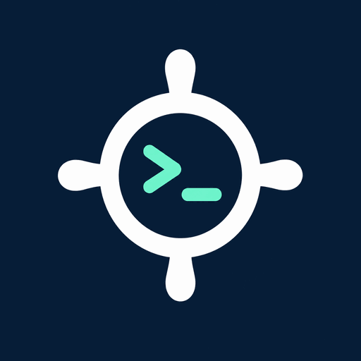

# CodeHelm

<p align="center">
  
</p>

<p align="center">
  <strong>Let Claude write the code. You steer the ship.</strong>
</p>

<p align="center">
  A lightweight human-in-the-loop workflow for Claude Code.
  <br />
  Recommended for engineers who love AI but refuse to surrender the steering wheel.
  <br />
  Specify → Plan → Implement → Audit: one tested and reviewable change at a time.
</p>

<br>

No mysterious AI-generated commits. No waking up to discover Claude refactored your entire application. Just a short approved plan, small tested tasks and a human firmly holding the wheel.

**AI is your crew, not your captain.**

## Install

In a Claude Code session (v2.1.275 or later), run:

```text
/plugin install codehelm --marketplace mvibraim/codehelm
```

On older versions, run `/plugin marketplace add mvibraim/codehelm`, then `/plugin install codehelm@codehelm`.

To update, run `claude plugin update codehelm@codehelm`, or turn on auto-update for the `codehelm` marketplace in `/plugin`.

## Quick start

```text
/model opus
/effort high
/codehelm:plan-tasks Add rate limiting to the public API   # answer questions, approve the plan
                                                           # you open the plan's pull request
                                                           # after it merges, you start feat/rate-limiting-s01
/clear
/model sonnet                       # the handoff suggests the switch
/effort medium
/codehelm:implement rate-limiting   # S01 starts, review it, reply "accepted"
                                    # you commit and open S01's pull request
                                    # after it merges, you start feat/rate-limiting-s02
/clear
/codehelm:implement rate-limiting   # the last task, S02
                                    # you commit the change
/clear
/codehelm:audit rate-limiting       # the full audit, runs on Opus at high by itself
                                    # you commit verification.md and open S02's pull request
```

## The four skills

- **`/codehelm:specify <brief>`** (optional): turns an incomplete business brief into an approved specification of one business feature at `docs/specs/<spec-slug>.md`.
- **`/codehelm:plan-tasks <request or spec>`**: asks its questions, then writes an approved plan of small tasks at `docs/plans/<plan-name>/plan.md`, with one ADR per design decision in `docs/adr/`; a small change gets a lite plan. Given a plan name, it amends that plan, for example when a task is blocked.
- **`/codehelm:implement <plan> [task]`**: implements one task test-first, runs the plan's test commands and stops for your review. Once you accept, it gives the `git add` and `git commit --trailer 'Task: <plan-name>/<task-id>'` commands to run (Git 2.32 or later) and suggests the task's pull request, whose description links the spec, the plan task and the IDs it covers.
- **`/codehelm:audit <plan> [task]`**: checks requirements, plan, ADRs, code and test evidence against each other in a separate subagent and records the result in `verification.md`.

## Task status

A task goes from `NOT STARTED` to `READY FOR HUMAN REVIEW` (every check passed) to `DONE` (you accepted it), or to `BLOCKED — <reason>`, and only `DONE` satisfies a dependency.

## Rules

1. **Nothing happens without your approval.** Specifications and plans are saved only after you approve them, and `/codehelm:implement` only runs tasks from an approved plan. A source that changed since approval stops the work until you approve again.
2. **You own Git.** CodeHelm never creates branches, stages, commits, pushes or opens pull requests unless you ask; it only suggests them. Every skill except `/codehelm:specify` needs a Git repository.
3. **One task per run and per pull request.** `/codehelm:implement` does one task whose dependencies are `DONE`, on that task's own branch, and stops for your review until you accept it.
4. **Tests gate every task.** The plan's test commands (unit and integration suites, plus build or lint) are approved with the plan, run before editing as a baseline (except the ones a setup task creates, and a resumed task's own tests) and after implementing. A failure the task did not cause blocks it.
5. **Evidence, not claims.** Only `/codehelm:audit` marks a requirement `VERIFIED`, never takes "tests passed" as proof and never changes code or task status.

## Tips

- **Start each skill in a fresh session.** The skills hand off through Markdown files, not chat, so each handoff ends with the next steps in order, such as commit, `/clear`, the model switch, then the next command. Don't clear while a task waits for your review: a task audit runs in its own subagent and returns to that review, so reply "accepted" first.
- **Use the recommended model and effort.** Run `/codehelm:specify` and `/codehelm:plan-tasks` on Opus at `high` effort, and `/codehelm:implement` on Sonnet at `medium`. `/codehelm:audit` always runs on Opus at `high` in its own subagent. Each skill asks before it runs on anything else, and each handoff names the switch for the next command.
- **Commit in the right order.** A feature takes a specification pull request, a plan pull request with its new ADRs, then one pull request per task, from the task's branch named in the plan (`feat/rate-limiting-s01`) and with the task's one commit. Start each pull request from the default branch after the ones it depends on merge; tasks that don't depend on each other can run in parallel. A plan from a plain request has no specification pull request, and a lite plan's commit goes on the first task's branch instead of its own pull request. Merge the specification before you approve the plan, so later runs can detect changes to it, and commit the plan before the first task, because `/codehelm:implement` stops on uncommitted changes. Reply "accepted" before you commit a task, so its `DONE` status lands in the same commit. Run the full audit before the last task's pull request, which also carries `verification.md`.

## License

CodeHelm is released under the [MIT License](LICENSE).
